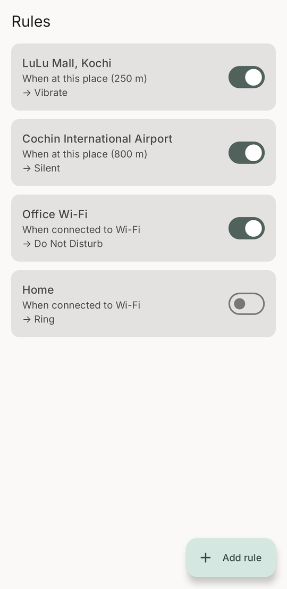
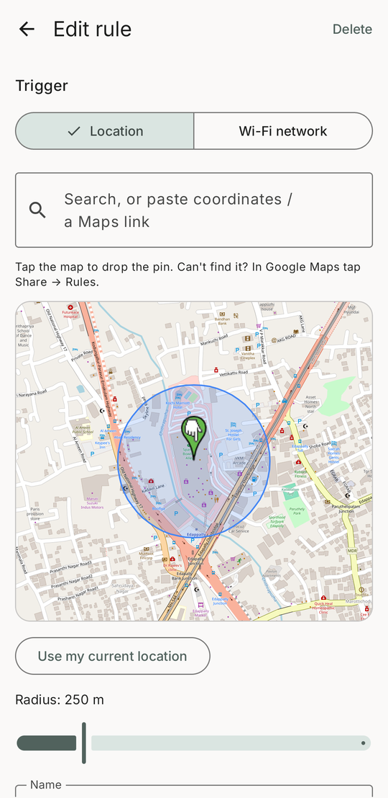
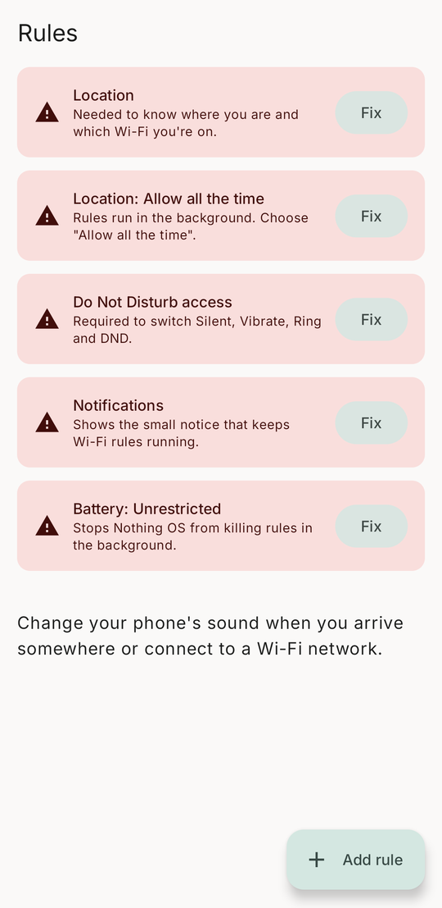

# Rules for Android

Change your phone's sound automatically when you arrive somewhere or connect to a Wi-Fi network. It's a small open-source take on the **Rules** feature that only Pixel phones get, for any Android 12+ phone. It was built for and tested on a Nothing Phone (2a) Plus.

- **Triggers:** arriving at a place (a geofence you pick on a map) or connecting to a Wi-Fi network.
- **Actions:** Silent, Vibrate, Ring, or Do Not Disturb.
- **Restore:** your own sound setting comes back when you leave. If rules overlap, the most recent one wins.

There are no ads and no accounts. Rules are stored only on the phone. The app uses the network for map tiles and place search only.

<p align="center">
  
  &nbsp;
  
  &nbsp;
  
</p>

## Install

Download the APK from [Releases](../../releases) and open it on your phone. You'll need to allow installing from your browser or file manager. The APK is signed with a development key, so Play Protect may warn about an unknown developer.

Then open the app and tap **Fix** on each card until none are left:

| Permission | Why |
|---|---|
| Location, then **Allow all the time** | Geofences and reading the Wi-Fi network name both run in the background |
| Do Not Disturb access | Android requires it to change Silent, Vibrate, Ring and DND |
| Notifications | Wi-Fi rules keep a small, silent notification so the system doesn't stop them |
| Battery: Unrestricted | Some phones (Nothing, Xiaomi, Samsung and others) kill background apps aggressively |

## Picking a place

- **Search:** the search box uses [Photon](https://photon.komoot.io), which searches OpenStreetMap data. It's good for roads, towns and landmarks, but thinner than Google Maps for small shops and offices.
- **Share from Google Maps:** find the place in Google Maps, tap **Share**, then **Rules**. The app opens Add rule with the pin placed. This covers anything Google Maps knows.
- **Paste:** the search box also accepts coordinates (`10.0274, 76.3079`) or a Google Maps link.
- **Tap the map:** the map uses OpenStreetMap tiles via [osmdroid](https://github.com/osmdroid/osmdroid). No Google API key is needed. The radius slider goes from 75 m to 1 km.

## Picking a Wi-Fi network

Since Android 10, apps can't read the phone's list of saved Wi-Fi networks. The picker shows the network you're connected to, networks in range, and every network the app has seen you connect to.

To add all your saved networks at once, use a computer with [adb](https://developer.android.com/tools/adb) and a debug build:

```sh
tools/import-wifi.sh            # or: tools/import-wifi.sh <adb-serial>
```

## How it works

| Piece | Android API |
|---|---|
| Place triggers | Play Services `GeofencingClient`. The OS watches the fences, so this costs almost no battery. Fences are re-registered after a reboot or an app update. |
| Wi-Fi triggers | A foreground service holding a `ConnectivityManager.NetworkCallback` with `FLAG_INCLUDE_LOCATION_INFO`. Only a live callback gets disconnect events and the network name. The service runs only while at least one Wi-Fi rule exists. |
| Sound | `AudioManager.ringerMode` and `NotificationManager.setInterruptionFilter` |

`SoundEngine` holds all of the state: your baseline setting and an ordered list of active rules. Every enter or exit event runs the same reconcile step. Repeated events, reboots, or deleting an active rule can't leave the phone stuck on silent.

Code layout, under `app/src/main/java/com/rafeeh/rules/`:

- `Rule.kt` defines the rule model and its storage.
- `SoundEngine.kt` contains the enter, exit and restore logic.
- `Triggers.kt` handles geofence registration and the boot and geofence receivers.
- `WifiWatchService.kt` watches Wi-Fi.
- `ui/` holds the Compose screens, the map picker, place search and Google Maps link parsing.

## Build

You need JDK 17+ and the Android SDK (platform 35). Android Studio works, or the command-line tools with `local.properties` pointing at the SDK.

```sh
./gradlew assembleDebug                 # app/build/outputs/apk/debug/app-debug.apk
adb install -r app/build/outputs/apk/debug/app-debug.apk
```

To regenerate the README screenshots, run `tools/screenshots.sh` with a phone connected and unlocked. It installs a separate demo copy of the app (`com.rafeeh.rules.demo`), seeds it with sample rules, captures the screens and uninstalls it again. Your own rules are never touched.

## Known limits

- Geofences usually fire on arrival within a minute or two. Leaving can take a few minutes, and accuracy indoors is lower. Wi-Fi rules react instantly.
- A Google Maps share link that holds only a place name (no coordinates) is looked up with Android's geocoder, so the pin can be slightly off. Tap the map to move the pin.
- Place triggers need Google Play Services.

## License

[MIT](LICENSE)
